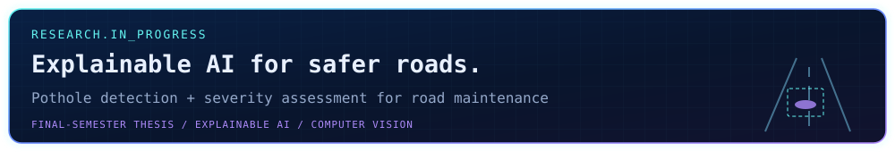

  <picture>
    <source media="(max-width: 600px)" srcset="./assets/heading-mobile.svg" />
    
  </picture>

<picture>
  <source media="(max-width: 600px)" srcset="./assets/hero-mobile.svg?v=27660e4692a5" />
  
</picture>

  
  
  
  

<picture>
  <source media="(max-width: 600px)" srcset="./assets/stats-mobile.svg?v=67265e6c68fd" />
  
</picture>

Auto-updated every 6 hours · Last refreshed: **31 October 2026, 18:35 BST (UTC+6)** · Language mix counts repositories by their primary language.

## `01` &nbsp; About me

I'm **Mohammad Asad Bin Jafor**, a final-semester **Computer Science & Engineering student at AIUB** and a **Full Stack Web Developer** based in Dhaka, Bangladesh.

I build practical web applications and database-driven systems, from multi-role e-commerce platforms to inventory and sales tools. My work combines **Next.js, React, NestJS, TypeScript, PHP and relational databases**, alongside object-oriented projects in **Java and C#/.NET**.

- **Education:** BSc in Computer Science & Engineering, AIUB · 2023–present · **CGPA 3.65/4.00**
- **Current focus:** Full-stack development, software testing, system analysis and explainable AI
- **Community:** AIUB Computer Club member · NASA Space Apps volunteer
- **Open to:** Internships, junior developer roles and project collaboration

<picture>
  <source media="(max-width: 600px)" srcset="./assets/research-mobile.svg" />
  
</picture>

## `02` &nbsp; Tech stack

**Languages**

**Frontend**

**Backend & databases**

`Oracle Database` · `Microsoft SQL Server` · `PL/SQL` · `TypeORM` · `REST APIs` · `JWT`

**Development, design & deployment**

`Jira` · `Jest` · `XAMPP` · `Draw.io` · `UML` · `Requirements Engineering` · `Software Testing`

## `03` &nbsp; Selected projects

| Project | What I built / am building | Stack |
| :--- | :--- | :--- |
| **[Tech Trolley](https://github.com/asadbinjafor/Tech-Trolley-Mobile-Shop-Inventory-and-Internal-Sales-Management-System)** | **Ongoing.** A multi-role mobile-shop inventory and internal sales platform. | Next.js · NestJS · TypeScript · PostgreSQL |
| **[Programming Contest Management](https://github.com/asadbinjafor/PROGRAMMING-CONTEST-MANAGEMENT-SYSTEM)** | A database-backed programming contest management system. | PHP · Oracle · OCI8 · PL/SQL |
| **[Online Medical Shop](https://github.com/asadbinjafor/Online-Medical-Shop-Web-Tech)** | Prescription/OTC browsing, order tracking and admin inventory across **10 modules and 18+ tables**. | PHP · MySQL · JavaScript |
| **[Online Mobile Shop](https://github.com/asadbinjafor/Mobile_Shop)** | A **20+ page** e-commerce system with product filtering, role-based sessions, stock tracking and invoices. | PHP · MySQL · JavaScript |
| **[AgriTech Village](https://github.com/asadbinjafor/AgriTech-Village-Management-System-OOP2)** | Farmer, land, crop, inventory and harvest management using **15+ classes and six modules**. | C# · .NET · Windows Forms |
| **[3D City, Castle & Village](https://github.com/asadbinjafor/Interactive-3D-Simulation-of-City-Castle-and-Village-Environments-Using-Computer-Graphics)** | Three interactive scenes with **50+ objects**, camera movement, lighting and animation. | C++ · OpenGL · GLUT |

<strong>More work: requirements engineering, Java, databases and file systems</strong>

 

- **[TrolleyHub](https://github.com/asadbinjafor/TROLLEYHUB---A-Centralized-Inventory-and-Sales-Management-System-SRE-REPORT):** Requirements engineering, UML and ER modeling, feasibility analysis, QA and project planning.
- **[Sporting Sphere Complex](https://github.com/asadbinjafor/JAVA-PROJECT--Sporting-Sphere-complex):** A Java/OOP sports facility management project.
- **[Course Management System](https://github.com/asadbinjafor/SQL-COURSE-MANAGEMENT-SYSTEM-PROJECT):** Relational database work for students, courses, grades and schedules.
- **[FTP Server Web Application](https://github.com/asadbinjafor/FTP_SERVER_WEB_TECH):** Authenticated uploads/downloads, directory navigation, permissions, logs and transfer-error handling.

  

## `04` &nbsp; Engineering focus

| Area | Experience & current focus |
| :--- | :--- |
| **Full-stack applications** | Multi-role interfaces, REST APIs, authentication and database-backed workflows |
| **Database systems** | Relational modeling, SQL, normalization, Oracle, MySQL and PostgreSQL |
| **Software engineering** | Requirements analysis, UML, OOP, technical documentation and testing |
| **AI & computer vision** | Academic learning and ongoing explainable-AI pothole detection research |

## `05` &nbsp; Learning & community

**Selected training**

- Front End Development, Software Testing and Web Development with ChatGPT — **Simplilearn SkillUP, 2026**
- Code to Cloud: Practical DevOps with AWS — **Cloudly Infotech, 2025**
- Edit and Transform Content with Microsoft 365 Copilot — **Microsoft, 2025**
- IT Essentials: PC Hardware and Software — **Cisco Networking Academy, 2023**

**Beyond the code**

- **General Member, AIUB Computer Club** — 2023–present
- **NASA International Space Apps Challenge** — local volunteer, 2024 & 2025
- **AIUB Cyber Gaming Fest** — organizer, 2025
- **MOS Bangladesh Championship** — volunteer, 2025
- **Broadband Expo** — project-showcase volunteer, 2026

<strong>Earlier education</strong>

 

- **HSC, Science:** Hazera Taju University & College, Chattogram · 2021 · **GPA 4.92/5.00**
- **SSC, Science:** Jorarjong Buddha High School · 2019 · **GPA 4.83/5.00**

 

<picture>
  <source media="(max-width: 600px)" srcset="./assets/footer-mobile.svg" />
  
</picture>

  
  
  
  
  

<strong>Build with purpose. Learn continuously.</strong>

